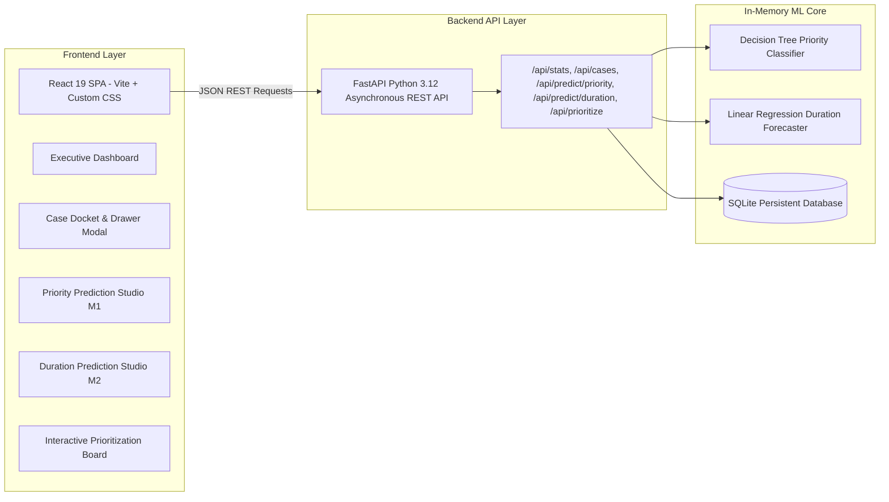
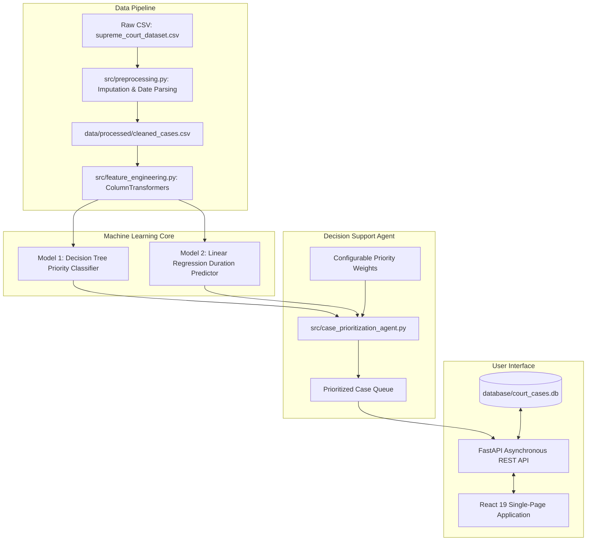

# justiq
**Justice delayed is justice denied**

[](https://www.python.org/)
[](https://react.dev/)
[](https://fastapi.tiangolo.com/)
[](https://scikit-learn.org/)
[](https://plotly.com/)
[]()

---

## 1. Project Introduction & Problem Statement
Case pendency and backlog present structural challenges across courts globally. In traditional judicial administration, cases are predominantly docketed on a **First-Come-First-Served (FCFS)** basis—scheduling hearings in strict chronological order of filing dates.

Under pure FCFS docketing:
- **Urgent personal liberty matters** (e.g., Habeas Corpus petitions, bail applications, undertrial custody matters) can experience protracted delay while waiting behind older, voluminous property or commercial disputes.
- **Bulky multi-party disputes** consume successive bench hours without considering case complexity or estimated disposal duration.
- Registrars lack explainable, data-driven tools to balance fundamental constitutional urgency with institutional seniority.

This project delivers a **decision-support prototype** engineered to assist court registrars and judicial administrators in prioritizing pending cases and forecasting case durations while preserving judicial discretion.

> **CRITICAL LEGAL NOTICE:**  
> This system is an administrative decision-support tool. It **does not replace judges, automate judicial rulings, or issue binding legal decrees**. All proposed priority ranks and urgency scores serve as advisory recommendations for court registries.

---

## 2. Key Project Objectives
1. **Analyze Supreme Court Case Records:** Perform comprehensive exploratory data analysis (EDA) on 7,378 case records spanning 1950–1975.
2. **Predict Case Priority (Model 1):** Classify pending cases into **High**, **Medium**, or **Low** priority using an interpretable **Decision Tree Classifier**.
3. **Predict Case Duration (Model 2):** Forecast estimated case disposal duration (days, months, years) using **Linear Regression ONLY**.
4. **Multi-Factor Case Prioritization:** Synthesize ML predictions, case age, hearing count, and statutory urgency into a transparent, configurable composite score ($0-100$).
5. **Modern Full-Stack Web Application:** High-performance **React SPA (Vite)** paired with an asynchronous **FastAPI REST API backend** maintaining Scikit-Learn models in-memory for sub-2ms inference.

---

## 3. High-Performance Architecture: React + FastAPI



---

## 4. Dataset Characteristics & Data Leakage Prevention

### Dataset Summary (`supreme_court_combined_dataset (1).csv`)
- **Total Records:** 7,378 historical Supreme Court cases (1950–1975).
- **Total Features:** 15 columns.
- **Duplicate Rows:** 0 (Verified).
- **Missing Values:** Only `bench_judges` contained 367 missing values (which corresponded exactly to `bench_size == 0`). These were imputed cleanly to the median Division Bench size (2 judges).

| Column Name | Type | Description | Role in Pipeline |
| :--- | :--- | :--- | :--- |
| `case_id` | String | Unique Supreme Court case identifier (e.g., `SC-00001`) | Primary Key / Tracking |
| `petitioner` | String | Initiating party / appellant | Registry Record |
| `respondent` | String | Defending party / state entity | Registry Record |
| `case_year` | Integer | Year case was filed / instituted (1950–1975) | Feature |
| `judgment_date` | Date | Actual date judgment was delivered | **LEAKAGE TARGET — EXCLUDED** |
| `filing_date_simulated` | Date | Simulated filing date | Feature / Reference Horizon |
| `case_duration_days_simulated`| Integer | Disposal duration in days ($judgment\_date - filing\_date$) | **Target for Model 2 ONLY** |
| `case_type` | Categorical | 10 legal categories (Constitutional, Criminal, Tax, Property, etc.) | Primary Feature |
| `num_hearings_simulated` | Integer | Total hearing sessions conducted ($1 - 12$) | Feature |
| `priority_level_simulated` | Categorical | High (13.4%), Medium (41.4%), Low (45.1%) | **Target for Model 1** |
| `assigned_judge_simulated` | Categorical | Designated judge ($Judge\_01$ through $Judge\_12$) | Registry Record |
| `bench_size` | Integer | Coram size (1, 2, 3, 4, 5, 6 judges) | Feature |
| `bench_judges` | String | Semicolon-delimited sitting judges | Roster Verification |
| `source_file` | String | Filename of original judgment PDF | Document Reference |
| `dataset_part` | String | Chronological epoch partition | Metadata |

### Data Leakage Safeguards
- **Strict Pre-Judgment Information Boundary:** For pending cases, `judgment_date` is unknown. It is strictly excluded from all model training features.
- **Duration Isolation:** `case_duration_days_simulated` is the target for Model 2 and is never fed as an input to Model 1.
- **Simulated Variables Disclosure:** The operational columns (`filing_date_simulated`, `priority_level_simulated`, `case_duration_days_simulated`) were generated as an academic testbed. They are clearly labeled as simulated in all documentation and UI components.

---

## 5. Machine Learning Models

### Model 1: Priority Classifier
- **Algorithm:** Decision Tree Classifier (`criterion='gini'`, `max_depth=5`, `min_samples_leaf=15`)
- **Objective:** Classify cases into **High Priority**, **Medium Priority**, or **Low Priority**.
- **Input Features:** `case_type` (One-Hot Encoded), `case_year`, `num_hearings_simulated`, `bench_size`, `case_age_days`.
- **Performance Metrics:**
  - **Test Accuracy:** `59.62%`
  - **Weighted Precision:** `60.12%`
  - **Weighted Recall:** `59.62%`
  - **Weighted F1-Score:** `57.99%`
- **Explainability:** Generates human-readable judicial rationales and feature importance charts based on legal decision paths (e.g., fundamental liberty cases branched to High Priority; property matters routed to Low Priority).

### Model 2: Case Duration Predictor
- **Algorithm:** Linear Regression ONLY (Strictly constrained per specification)
- **Objective:** Forecast estimated duration in days, months, and years.
- **Input Features:** `case_type` (One-Hot Encoded), `num_hearings_simulated`, `bench_size`, `case_year`.
- **Performance Metrics:**
  - **Mean Absolute Error (MAE):** `364.67 days`
  - **Root Mean Squared Error (RMSE):** `448.27 days`
  - **R-squared ($R^2$):** `0.4284`
- **Key Regression Coefficients:**
  - `Bail Matter`: $-686.13$ days (fastest disposal)
  - `Habeas Corpus`: $-662.51$ days
  - `Constitutional / Writ`: $-230.54$ days
  - `Criminal Appeal`: $+108.14$ days
  - `Civil Appeal - Property`: $+703.80$ days (longest duration)
- **Documented Limitations:** Linear regression assumes additive, homoscedastic relationships; real court litigation suffers from non-linear adjournment delays, right-skewness, and requires non-negative truncation (enforced at 14 days minimum).

---

## 6. AI Case Prioritization Agent
The Prioritization Agent synthesizes model predictions and registry operational metrics into a normalized composite score:

$$\text{Composite Score} = 100 \times \left( w_{\text{pri}} S_{\text{pri}} + w_{\text{age}} S_{\text{age}} + w_{\text{hear}} S_{\text{hear}} + w_{\text{dur}} S_{\text{dur}} + w_{\text{urg}} S_{\text{urg}} \right)$$

### Default Factor Weights (Configurable in UI)
| Factor | Default Weight | Description |
| :--- | :---: | :--- |
| **Priority Tier ($S_{\text{pri}}$)** | $40\%$ | Base score: High = $1.0$, Medium = $0.5$, Low = $0.2$ |
| **Case Age / Pendency ($S_{\text{age}}$)** | $25\%$ | Normalized days pending from filing date (prevents case starvation) |
| **Hearing Count ($S_{\text{hear}}$)** | $15\%$ | Cases with prolonged hearings require final resolution |
| **Fast-Track Duration ($S_{\text{dur}}$)** | $10\%$ | Shorter cases can be disposed without blocking benches |
| **Statutory Urgency ($S_{\text{urg}}$)** | $10\%$ | Fundamental liberty bonus (Bail, Habeas Corpus, Election) |

---

## 7. System Architecture



---

## 8. Full-Stack Web Application Views

The application provides 5 responsive, specialized views:

- **Executive Dashboard**: High-level judicial analytics, demographic distributions, boxplots, and ML performance cards.
- **Case Docket Explorer**: Multi-dimensional filtering (case type, priority, year), text search, and single-case dossier inspector.
- **Priority Prediction Studio (Model 1)**: Real-time Decision Tree inference form, probability distributions, and transparent decision path rationales.
- **Duration Prediction Studio (Model 2)**: Linear Regression duration estimator (days, months, years) with regression coefficient impact analysis.
- **Interactive Prioritization Agent**: Multi-factor priority weight tuning sliders, real-time composite score re-ranking, and CSV export.

---

## 9. Installation & Execution Guide

### Prerequisites
- macOS, Linux, or Windows with **Python 3.10+** (tested on Python 3.12) and **Node.js 18+**.
- Terminal with `zsh` or `bash`.

### Step 1: Install Dependencies
```bash
pip install -r requirements.txt
npm install --prefix frontend
```

### Step 2: Run Unit Tests
```bash
python3 -m unittest discover tests
```

### Step 3: Launch the Application
1. **Start the FastAPI Backend API Server (Port 8000):**
   ```bash
   python3 -m uvicorn backend.api:app --host 127.0.0.1 --port 8000
   ```
   *Swagger API documentation: `http://localhost:8000/docs`*

2. **Start the React Frontend Dev Server (Port 5173):**
   ```bash
   npm run dev --prefix frontend
   ```
   *Web application: `http://localhost:5173`*

---

## 10. Repository Directory Structure
```
court-case-project/
│
├── requirements.txt                  # Python backend dependencies
├── README.md                         # Comprehensive project documentation
├── .gitignore                        # Git exclusion rules
│
├── backend/                          # FastAPI REST API Server
│   ├── __init__.py
│   └── api.py                        # Asynchronous REST endpoints & ML routing
│
├── frontend/                         # React 19 Single-Page App (Vite)
│   ├── src/
│   │   ├── components/               # Active views (Dashboard, Docket, Priority, Duration, Prioritization)
│   │   ├── services/                 # REST API client
│   │   ├── App.jsx                   # Main layout container
│   │   └── App.css                   # Custom judicial theme styling
│   ├── index.html
│   ├── vite.config.js
│   └── package.json
│
├── data/
│   ├── raw/
│   │   ├── supreme_court_dataset.csv # Raw Supreme Court CSV dataset (7,378 rows)
│   │   └── supreme_court_combined_dataset (1).csv
│   └── processed/
│       └── cleaned_cases.csv         # Cleaned, imputed, feature-ready dataset
│
├── models/                           # Serialized model artifacts & metric files
│   ├── priority_tree_model.joblib
│   ├── priority_preprocessor.joblib
│   ├── priority_metrics.json
│   ├── duration_linear_model.joblib
│   ├── duration_preprocessor.joblib
│   └── duration_metrics.json
│
├── notebooks/
│   └── exploratory_data_analysis.ipynb # Interactive Jupyter EDA notebook
│
├── src/                              # Core ML & Agent modules
│   ├── __init__.py
│   ├── preprocessing.py              # Data cleaning, date parsing, leakage prevention
│   ├── feature_engineering.py        # ColumnTransformers and categorical encoders
│   ├── priority_classifier.py        # Model 1: Decision Tree Priority Classifier
│   ├── duration_predictor.py         # Model 2: Linear Regression Duration Predictor
│   └── case_prioritization_agent.py  # Multi-factor ranking engine
│
├── database/
│   ├── __init__.py
│   ├── database.py                   # SQLite schema, queries & persistence layer
│   └── court_cases.db                # SQLite database
│
└── tests/                            # Automated Unit Test Suite
    ├── test_preprocessing.py         # Tests imputation & zero leakage
    └── test_models.py                # Tests prediction bounds & metrics
```

---

## 11. Academic Integrity & Honest Reporting
- **No Fabricated Predictions:** All model evaluations are derived strictly from reproducible train/test splits.
- **Explainable Decision Paths:** Both the Decision Tree and the Prioritization Agent provide transparent, auditable rationales rather than opaque black-box predictions.
